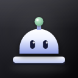

<div align="center">



# Agent Frontdesk

**One web page for every desktop AI on your computer.**<br>
To add a new one, send it a prompt and it connects itself.

[](https://github.com/Phz-06/agent-frontdesk/actions/workflows/ci.yml)
[](LICENSE)


[](CONTRIBUTING.md)

[Quick start](#quick-start) · [Add an AI](#add-an-ai) · [How it works](#how-it-works) · [Roadmap](#roadmap) · [简体中文](README.zh-CN.md)

<table>
<tr>
<td width="50%">
<picture>
  <source media="(prefers-color-scheme: dark)" srcset="docs/images/frontdesk-en-dark.png">
  
</picture>
</td>
<td width="50%">
<picture>
  <source media="(prefers-color-scheme: dark)" srcset="docs/images/frontdesk-preview-en-dark.png">
  
</picture>
</td>
</tr>
<tr>
<td align="center"><sub>Several AIs at work, each with its latest line next to its avatar</sub></td>
<td align="center"><sub>A file from a reply opens in the preview on the right, and the desktop app is one click away</sub></td>
</tr>
</table>

</div>

## Why

We subscribe to several AIs, and each one has its own desktop app. Working with them meant switching between windows all day and trying to remember which one was running and how far it had got.

Agent Frontdesk puts those desktop apps into one web page. The apps still do the work, on your own account and subscription. The page only carries your messages over and brings the progress back. Both sides are the same session, so you can go back to the desktop app and carry on at any time.

## Features

- All your AIs sit in a rail on the left. You can see who is running, who has a new reply and how much quota is left, and each one's latest line pops up next to its avatar
- The sidebar has each AI's projects and chats, grouped the way its desktop app groups them, with search and a list of recent chats
- Continue any chat, or start a new one in a project
- Send, steer a running turn, queue, stop. Switching to another AI while one is running does not interrupt it
- Change the model, reasoning effort and permissions, attach images and files, dictate
- Answer the AI's questions and approval requests right in the page
- Replies look the way each desktop app shows them, with code, maths, diagrams, tool steps and plans
- A file mentioned in a reply opens in a preview on the right with one click, or shows in Finder
- Any chat opens in its desktop app with one click, on the same session
- Switch AIs on and off, rename them, reorder them, change their avatars. Light and dark, English and Chinese

## Quick start

You need macOS or Windows 11 and [Node.js](https://nodejs.org) 22.16 or later. This fork ports the project to Windows 11 (its send engine compiles a small .NET helper; see [docs/windows-deploy.md](docs/windows-deploy.md) for what works today and what is still waiting for its desktop app).

```sh
git clone https://github.com/Phz-06/agent-frontdesk.git
cd agent-frontdesk
npm ci
npm start
```

Open <http://127.0.0.1:4100>. Every AI whose desktop app is installed shows up in the rail, and you can switch them on and off under **+**.

Codex, Claude and Antigravity are connected so far. Open the desktop app and sign in before you use one.

Sending to Codex and Claude needs the Accessibility permission. In System Settings → Privacy & Security → Accessibility, allow the terminal app you run `npm start` in, then start Frontdesk again. For now, keep the desktop apps' interface in English.

Claude's model list, quota and voice input also need Claude Code signed in once, with the account the desktop app uses. When it is not, the page shows the command to run in a terminal.

If the port is taken, run `PORT=4200 npm start`.

## Add an AI

Frontdesk is meant for every desktop AI, so connecting one is a job for the AI itself. Click **+** in the rail, copy the prompt and send it to the AI you want to add. It follows [the onboarding guide](skills/add-desktop-engine/SKILL.md) and writes its own plugin: it reads its own data, picks a channel for sending, and declares what it can do.

It does not build any pages. The sidebar, conversation, composer, cards, file preview, queue and quota are shared, and a new AI gets them all. Everything a plugin implements is in one file, [`src/shared/contract.ts`](src/shared/contract.ts).

## How it works

Frontdesk is a small server on your computer. It reads the records each desktop app keeps locally to show history and progress. To send, it uses the app's own channel: an interface where the app has one, and otherwise the macOS Accessibility API, which fills in the message and presses Send in the app's window in the background, without bringing it to the front.

```
 Browser ──▶ Frontdesk server ──▶ a plugin per AI ──▶ the desktop app
                              ◀── the app's local records
```

| AI | Reads history from | Sends through |
| --- | --- | --- |
| Codex | Codex's local app-server | Codex's own message queue and its window-to-window channel, with macOS Accessibility for new chats and model changes |
| Claude | Claude Code's session transcripts | macOS Accessibility |
| Antigravity | Its local database and transcripts | Its local language server |

Whether a turn has finished is decided by the desktop app's own record. These channels can change when a desktop app updates, and we update with them.

More detail is in [docs/architecture.md](docs/architecture.md).

## Configuration

All optional. Frontdesk finds standard install locations by itself.

<details>
<summary>Environment variables</summary>

| Variable | Purpose | Default |
| --- | --- | --- |
| `HOST` / `PORT` | Address the server listens on | `127.0.0.1` / `4100` |
| `HTTPS_PORT` | HTTPS port with a self-signed certificate, for the microphone on other devices; `0` turns it off | `PORT + 1` when `HOST` is not local |
| `BRIDGE_DEFAULT_CWD` | Working folder for new chats | your home folder |
| `BRIDGE_UPLOADS_DIR` | Where attachments are stored | `uploads/` in the project |
| `BRIDGE_SETTINGS_FILE` | Where it keeps which AIs are on, their names and order | `.frontdesk.json` in the project |
| `BRIDGE_PLUGIN_DIR` | Folder the plugins are loaded from | `dist/server/plugins` |
| `BRIDGE_MODEL_CATALOG` | JSON file of model IDs for AIs that cannot list their own | none |
| `BRIDGE_DICTATION_ENGINE` | Which AI's speech-to-text voice input tries first; it falls back to another AI's or the browser's | `claude` |
| `CODEX_BIN` / `CODEX_HOME` | Codex executable and data folder | found on `PATH` or in ChatGPT.app / `~/.codex` |
| `CLAUDE_BIN` / `CLAUDE_HOME` | Claude Code executable and session folder | found on `PATH` or in Claude's app data / `~/.claude` |
| `CLAUDE_DESKTOP_HOME` | Claude desktop app's data folder | `~/Library/Application Support/Claude` |
| `AGENTAPI_BIN` / `ANTIGRAVITY_HOME` | Antigravity's CLI and data folder | `~/.gemini/antigravity` |
| `CHATGPT_APP_ASAR` / `CLAUDE_APP_ASAR` / `ANTIGRAVITY_APP_ICON` | Installed apps that icons, characters and fonts are read from | under `/Applications` |

</details>

## Security and privacy

- The server listens on your own machine only and has no login, so do not expose it to the internet
- Chats stay on your computer. There is no telemetry and no server of ours
- Voice input and quota use Claude Code's own sign-in, read on the server only
- The Accessibility permission goes to the terminal that runs Frontdesk

To report a vulnerability, see [SECURITY.md](SECURITY.md).

## Roadmap

- Windows support
- More desktop AIs
- Full support for desktop apps set to Chinese and other interface languages
- A login, so you can check in and send from your phone

## Development

```sh
npm run dev      # page with hot reload on PORT, server on PORT+1
npm test
npm run check    # type check and build
```

Issues and pull requests are welcome. See [CONTRIBUTING.md](CONTRIBUTING.md).

## License

[MIT](LICENSE). Agent Frontdesk is an independent project, not affiliated with OpenAI, Anthropic or Google. Product names are trademarks of their owners.
