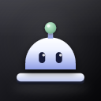

<div align="center">



# Agent Frontdesk

**一个网页，用上你电脑里所有的桌面版 AI。**<br>
想加新的 AI，把一段提示词发给它，它自己接进来。

[](https://github.com/Phz-06/agent-frontdesk/actions/workflows/ci.yml)
[](LICENSE)


[](CONTRIBUTING.md)

[快速开始](#快速开始) · [接入新的 AI](#接入新的-ai) · [工作原理](#工作原理) · [未来计划](#未来计划) · [English](README.md)

<table>
<tr>
<td width="50%">
<picture>
  <source media="(prefers-color-scheme: dark)" srcset="docs/images/frontdesk-zh-dark.png">
  
</picture>
</td>
<td width="50%">
<picture>
  <source media="(prefers-color-scheme: dark)" srcset="docs/images/frontdesk-preview-zh-dark.png">
  
</picture>
</td>
</tr>
<tr>
<td align="center"><sub>几个 AI 同时在跑，头像旁边是它们刚说的话</sub></td>
<td align="center"><sub>回复里的文件点一下就在右边预览，也能直接回到桌面应用</sub></td>
</tr>
</table>

</div>

## 为什么做这个

我们手上有好几家 AI 的订阅，每家一个桌面应用。干活的时候要在几个窗口之间来回切，还得记着刚才是谁在跑、跑到哪一步了，很麻烦。

Agent Frontdesk 把这些桌面应用放进同一个网页。干活的还是各家的桌面应用，用的是你自己的账号和订阅，网页只负责把消息送过去、把进度拿回来。两边是同一个会话，随时可以切回桌面版接着聊。

## 能做什么

- 左边一栏排着所有 AI，谁在跑、谁有新回复、额度还剩多少都看得到，头像旁边会冒出它刚说的话
- 侧栏里是每个 AI 的项目和聊天，分组和桌面版一致，可以搜索，也有最近聊天
- 打开已有的聊天接着聊，或者在某个项目里开一个新的
- 发消息、插话、排队、停止。一个 AI 在跑的时候切去看别的，不会打断它
- 改模型、推理强度和权限，带图片和文件，语音输入
- AI 提的问题和要你确认的操作，直接在网页上回答
- 回复按各家桌面版的样子显示，代码、公式、图表、工具步骤、计划清单都在
- 回复里提到的文件，点一下就在右边打开预览，也可以在 Finder 或资源管理器里显示
- 任何一个聊天都能一键在桌面应用里打开，回到同一个会话接着用
- AI 可以随时开关、改名、排序、换头像，有浅色和深色，中文和英文

## 快速开始

需要 macOS 或 Windows 11 和 [Node.js](https://nodejs.org) 22.16 以上。本 fork 把项目移植到了 Windows 11（静默发送引擎用 .NET 编译一个小驱动；各桌面应用在 Windows 上的现状与限制见 [docs/windows-deploy.md](docs/windows-deploy.md) 与 [docs/windows-port-notes.md](docs/windows-port-notes.md)）。

```sh
git clone https://github.com/Phz-06/agent-frontdesk.git
cd agent-frontdesk
# Windows 克隆后先关闭 CRLF 自动转换，确保源码匹配测试按 LF 运行：
git config core.autocrlf false
npm ci
npm start
```

打开 <http://127.0.0.1:4100>。电脑上装了哪个桌面应用，哪个 AI 就会出现在左边一栏里，之后可以在栏里的 **+** 中开关。

目前已经接好的有 Codex、Claude 和 Antigravity，用之前先把对应的桌面应用打开并登录。

在 macOS 上，给 Codex 和 Claude 发消息需要辅助功能权限：在「系统设置 → 隐私与安全性 → 辅助功能」里允许你运行 `npm start` 的那个终端应用，然后重新启动 Frontdesk。Windows 11 不需要此系统权限（会自动用 .NET 编译本机 UIA 驱动，支持范围见 [docs/windows-deploy.md](docs/windows-deploy.md)）。桌面应用的界面语言建议先用英文。

Claude 的模型列表、额度和语音输入还要登录一次 Claude Code，用和桌面版相同的账号。没登录时页面会给出要运行的命令，在终端跑一次就行。

端口被占用时用 `PORT=4200 npm start`（Windows PowerShell 下用 `$env:PORT=4200; npm start`）。

## 接入新的 AI

Frontdesk 的目标是所有桌面版 AI，所以接入这件事交给 AI 自己做。点左边一栏里的 **+**，复制里面的提示词，发给你想接入的那个 AI。它会照着[接入手册](skills/add-desktop-engine/SKILL.md)给自己写一个插件：读自己的数据，选好发消息的通道，声明自己能做什么。

页面不用它管。侧栏、对话、输入框、卡片、文件预览、排队和额度都是共用的，新接入的 AI 直接就有。插件要实现的内容都在 [`src/shared/contract.ts`](src/shared/contract.ts) 这一个文件里。

## 工作原理

Frontdesk 是跑在你电脑上的一个小服务。它读各家桌面应用留在本机的记录来显示历史和进度。发消息时走桌面应用自己的通道：应用有接口的用接口，没有的在 macOS 通过辅助功能（在 Windows 11 通过 UI Automation，详见 [docs/windows-deploy.md](docs/windows-deploy.md)）在后台操作应用的窗口，填好消息、按下发送，不会把窗口抢到前台。

```
 浏览器 ──▶ Frontdesk 服务 ──▶ 每个 AI 一个插件 ──▶ 桌面应用
                           ◀── 桌面应用的本机记录
```

| AI | 历史从哪读 | 消息怎么发 |
| --- | --- | --- |
| Codex | Codex 本机的 app-server | Codex 自己的消息队列和窗口间通道，新建聊天和改模型在 macOS 用辅助功能（Windows UIA 现状见 [docs/windows-deploy.md](docs/windows-deploy.md)） |
| Claude | Claude Code 的会话记录 | macOS 辅助功能（Windows 11 用 UIA，现状见 [docs/windows-deploy.md](docs/windows-deploy.md)） |
| Antigravity | 它的本地数据库和会话记录 | 它本机的 language server |

一轮对话有没有完成，以桌面应用自己的记录为准。桌面应用更新后这些通道可能会变，我们会跟着更新。

更细的说明在 [docs/architecture.md](docs/architecture.md)。

## 配置

都是可选的，标准安装位置 Frontdesk 自己会找。

<details>
<summary>环境变量</summary>

| 变量 | 用途 | 默认 |
| --- | --- | --- |
| `HOST` / `PORT` | 服务监听的地址 | `127.0.0.1` / `4100` |
| `HTTPS_PORT` | 自签名证书的 HTTPS 端口，给其他设备用麦克风，`0` 关闭 | `HOST` 不是本机地址时为 `PORT + 1` |
| `BRIDGE_DEFAULT_CWD` | 新聊天的默认工作目录 | 你的 home 目录 |
| `BRIDGE_UPLOADS_DIR` | 附件存放位置 | 项目里的 `uploads/` |
| `BRIDGE_SETTINGS_FILE` | 哪些 AI 开着、它们的名字和顺序存在哪 | 项目里的 `.frontdesk.json` |
| `BRIDGE_PLUGIN_DIR` | 从哪个目录加载插件 | `dist/server/plugins` |
| `BRIDGE_MODEL_CATALOG` | 给列不出自己模型的 AI 用的模型 ID JSON 文件 | 无 |
| `BRIDGE_DICTATION_ENGINE` | 语音输入先试哪个 AI 的识别，用不了时换其他 AI 的或浏览器的 | `claude` |
| `CODEX_BIN` / `CODEX_HOME` | Codex 可执行文件和数据目录 | 从 `PATH` 或 ChatGPT.app 里找 / `~/.codex`（Windows 默认见 [docs/windows-deploy.md](docs/windows-deploy.md)） |
| `CLAUDE_BIN` / `CLAUDE_HOME` | Claude Code 可执行文件和会话目录 | 从 `PATH` 或 Claude 的应用数据里找 / `~/.claude` |
| `CLAUDE_DESKTOP_HOME` | Claude 桌面应用的数据目录 | `~/Library/Application Support/Claude`（Windows 为 `%APPDATA%\Claude`） |
| `AGENTAPI_BIN` / `ANTIGRAVITY_HOME` | Antigravity 的命令行工具和数据目录 | `~/.gemini/antigravity` |
| `CHATGPT_APP_ASAR` / `CLAUDE_APP_ASAR` / `ANTIGRAVITY_APP_ICON` | 从这些已安装的应用里读图标、角色和字体 | macOS 在 `/Applications` 下（Windows 默认见 [docs/windows-deploy.md](docs/windows-deploy.md)） |

</details>

## 安全与隐私

- 服务只监听本机，没有登录，不要把它暴露到公网
- 聊天都留在你的电脑上，没有遥测，也没有我们的服务器
- 语音输入和额度用的是 Claude Code 自己的登录信息，只在服务端读取
- 在 macOS 上，辅助功能权限给的是运行 Frontdesk 的那个终端（Windows 使用 UI Automation，无需系统级辅助功能授权）

报告漏洞见 [SECURITY.md](SECURITY.md)。

## 未来计划

- Windows 11 移植（本 fork；上游主线仍在计划中）
- 接入更多桌面版 AI
- 桌面应用用中文等其他界面语言时也能完整使用
- 加上登录，在手机上远程查看和发消息

## 开发

```sh
npm run dev      # 页面热更新在 PORT，服务端在 PORT+1（POSIX shell；Windows 请在 Git Bash 中运行）
npm test
npm run check    # 类型检查加构建
```

欢迎提 issue 和 PR，见 [CONTRIBUTING.md](CONTRIBUTING.md)。

## 许可

[MIT](LICENSE)。Agent Frontdesk 是独立项目，与 OpenAI、Anthropic、Google 没有关联，各产品名称是其所有者的商标。
