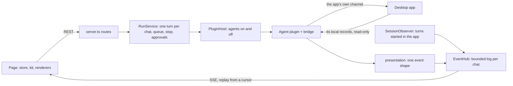

# Architecture

Agent Frontdesk is a small local server and a web page. The page is a remote window onto each coding agent's desktop app: it shows the app's own conversations and carries messages to and from it. Running a turn, editing files and keeping history stay with the desktop app.

Three rules shape everything below.

1. **The desktop app is the only writer.** Frontdesk never runs a turn in a CLI or SDK process of its own. Every message goes in through the desktop app's own channel, so the app shows it at once and its context is never forked.
2. **State needs evidence.** A turn is shown as completed, failed or stopped only when the app's own record says so. Without evidence the page says it is still being confirmed.
3. **Nothing is hard-coded per agent.** The page never asks which agent it is talking to. An agent is a plugin that declares what it can do; everything two agents share is written once.

The reasons behind these rules are in [the design philosophy](../skills/add-desktop-engine/references/philosophy.md).

## The path of a message



## Source layout

Everything is strict TypeScript (`strict`, `noUncheckedIndexedAccess`, no `any`) under `src/`. `npm run build` writes `dist/`, which is not committed.

```
src/
  shared/contract.ts    the plugin contract: engine methods, sessions / turns / steps, events, capabilities
  shared/guards.ts      narrowing helpers; every native record starts as `unknown`
  server/               server.ts (routes), config.ts, paths.ts, one <agent>-bridge.ts per agent
  server/core/          plugin-host, run-service, event-hub, presentation, desktop-automation, settings-store, agent-looks, attachments
  server/services/      session-observer, activity-feed, usage-service, file-preview, dictation, tool-catalog, readers for the apps' files
  server/plugins/       <agent>.plugin.ts: what an agent declares and how its methods map to its bridge
  server/native/        the Swift accessibility helper (ax-driver.swift + one flow per agent) and profiles/*.json
  client/               index.html, app.ts, js/ (store, sidebar, renderers, i18n, ...), kit/ (the shared chat UI)
  client/public/        copied as is: skins/<agent>/skin.css, the logo, stand-in characters
test/                   node:test, run through tsx; no real agent is ever contacted
```

- `npm start` builds, then runs `node dist/server/server.js`, which also serves the page from `dist/public`.
- `npm run dev` runs Vite with HMR on `PORT` (4100) and the server under `tsx watch` on `PORT+1`. A server started this way is a child process without the macOS Accessibility permission, so anything that drives a desktop window has to be tried on a server started from a terminal (`npm start`).
- `npm run check` is the type check (three `tsconfig` files, one each for server, page and tests) plus the build.
- The Swift helper is not part of `dist/`. It is compiled on first use (Xcode Command Line Tools) and cached by source hash in `~/Library/Caches/agent-frontdesk/`.
- Art and fonts that belong to a desktop app (icons, characters, typefaces) are read from the installed app at run time and served from `/api/characters/:name`. None are copied into the repository.

## Server

| Module | What it does |
| --- | --- |
| `config.ts` | Environment variables and discovery of installed apps and binaries. No user folder, version number or model list is written into the code. |
| `core/plugin-host.ts` | Finds `*.plugin.ts`, checks the contract, and switches agents on and off while the server runs. |
| `core/run-service.ts` | One turn at a time per chat, the message queue, steering, stop, approvals, time-outs, and a single final state per turn. |
| `core/presentation.ts` | Turns each agent's history and live events into one shape: commentary, final answer, tool activity, artifacts. Raw reasoning and patches never enter the event stream. |
| `core/event-hub.ts` | A bounded in-memory log per chat (by count and bytes) with its own sequence, replayed to a page that reconnects. After a restart the page reads the app's history again. |
| `core/desktop-automation.ts` | Compiles and runs the accessibility helper, one command at a time, and keeps the app's accessibility tree warm while Frontdesk is in use. |
| `core/settings-store.ts`, `core/agent-looks.ts` | What the person chose in the console: which agents are on, their names, order and faces (`.frontdesk.json`, `.frontdesk-avatars/`, both git-ignored). |
| `services/session-observer.ts` | While a page is watching a chat that Frontdesk is not running, re-reads the app's record and emits `session.snapshot` when it changes. Polling lives only at this boundary. |
| `services/activity-feed.ts` | The lightweight overview stream behind the agent rail: who is running, what just finished, the last line each agent said. Prompts and tool output are not in it. |
| `services/usage-service.ts` | Quota windows an agent reports, cached for a minute. An agent with no quota interface says so; nothing is estimated. |
| `services/file-preview.ts` | Read-only file contents for links in a reply, limited to the chat's working folder and folders the agent names; key files and `.git` are refused. |
| `services/tool-catalog.ts` | Rules that turn a tool call into a one-line summary; plugins add their own with `registerTool`. |

## Agents are plugins

A plugin file (`src/server/plugins/<id>.plugin.ts`) exports two things:

- `about`: the agent's name, colour and app icon, and `detect()`, which only looks whether its desktop app is on this machine. It has no side effects.
- `setup({ config, registerEngine, registerAsset })`: builds the bridge and registers the engine. It may return a function that releases what it holds.

```ts
import type { PluginAbout, PluginSetup } from '../../shared/contract.js';
import { appPlaces, firstExisting } from '../services/app-assets.js';
import { ExampleBridge } from '../example-bridge.js';

const IDENTITY = { id: 'example', label: 'Example', priority: 40, accent: '#7A5AF8' } as const;
export const about: PluginAbout = { ...IDENTITY, detect: () => firstExisting(appPlaces('/Applications/Example.app/')) };

export const setup: PluginSetup = ({ config, registerEngine }) => {
  const bridge = new ExampleBridge(config);
  registerEngine({
    ...IDENTITY,
    capabilities: { attachments: false, cwd: true, interrupt: false },
    status: () => bridge.status(), models: () => bridge.models(),
    list: () => bridge.list(), read: id => bridge.read(id),
    create: input => bridge.create(input), send: (id, input) => bridge.send(id, input),
  });
  return () => bridge.close();
};
```

`status / models / list / read / create / send` are required. Everything else (`interrupt`, `steer`, `decide`, `observe`, `usage`, `projects`, `openFile`, ...) is optional and switched on by a capability flag; the page shows a control only when the flag is there. The full contract is `src/shared/contract.ts`, explained in [plugin-contract.md](../skills/add-desktop-engine/references/plugin-contract.md).

**On and off.** At start the host reads `about` only. An agent the person has not chosen yet is on when `detect()` finds its app and off otherwise, so a missing app starts no bridge and reports no error. After that the person's choice wins (`.frontdesk.json`). `PUT /api/agents/:id { enabled }` runs `setup` or takes back everything it registered, without a restart: the engine leaves the lists, and the server drops what it kept for it (runs, observers, usage, event logs, open streams). Switching an agent off while Frontdesk follows one of its turns answers 409 with the counts until the page confirms with `force`. The turn itself goes on in the desktop app, which never depended on the console. Every open page hears about the change on the overview stream.

## How each agent is reached

| | Reads history from | Sends, steers and stops through |
| --- | --- | --- |
| **Codex** | Its app-server (`thread/read`, which takes no writer lock) and its session logs | Its own queue (`thread/queue/add`) plus a background wake link; steer and stop over the desktop's window-to-window IPC; new chats and model changes through the accessibility helper |
| **Claude** | Claude Code's session transcripts and the desktop app's index | The accessibility helper: it opens the chat in the background, fills the composer and presses Send, without bringing the app to the front |
| **Antigravity** | Its local database and transcripts | Its local language server, the channel its own composer uses |

Why each channel was chosen, what was ruled out, and how the accessibility helper is built are in [channels.md](../skills/add-desktop-engine/references/channels.md). Two things are worth knowing here:

- **The helper would rather do nothing than do the wrong thing.** Controls are found by what a language change does not touch (DOM classes, declared shortcuts, page addresses, position) with the name as a fallback. Before a press or a fill, the control must be the only match; a menu button found by position must prove itself by a row its menu always has. Otherwise the command fails with a reason and nothing is sent.
- **Settings follow the message.** A model, effort or permission mode picked in the console is changed in the desktop app's own menu first, then the message is sent. If the change cannot be made, nothing is sent.

## Events

A chat's stream (`GET /api/sessions/:engine/:id/events`, SSE) carries `bridge` events:

```json
{"id":"epoch:seq","seq":1,"engine":"codex","sessionId":"...","turnId":"...","type":"activity.upsert","data":{"id":"tool","kind":"command","title":"Ran command · npm test","status":"running"},"timestamp":"..."}
```

Types: `run.started`, `message.updated`, `activity.upsert`, `artifact.upsert`, `approval.requested`, `approval.resolved`, `run.completed`, `run.failed`, `run.interrupted`, `session.snapshot`. A message is always sent as its whole current text, so a replay never doubles it. The page reconnects with `Last-Event-ID`; when the cursor has expired or the server restarted, it gets `reset` and reads the app's history again. A stream owns nothing: closing it or switching chats never stops a turn.

## Page

- `js/store.ts`: reducers per event type, de-duplication, and reconciling live events with the history read from the app.
- `kit/`: the chat UI every agent shares: the project sidebar, turns, tool rows, step lists, question and wrap-up cards, the composer and its model / effort / permission menus. An agent's skin only sets `--kit-*` variables; what only one agent has is added as a registered renderer.
- `js/renderers.ts`: Markdown (sanitised, cached by text), code highlighting, maths and diagrams, loaded when first needed.
- `js/sidebar.ts`, `js/agents.ts`, `js/navigation.ts`: the sidebar, the agent rail and its switches, and per-chat drafts and read marks kept in the browser.
- `js/i18n.ts`: interface text is written in Chinese and looked up for English with `t()`; text a bridge reports goes through the same table. Chat content is never translated.

The parts Frontdesk draws itself (agent rail, sidebar, header, dialogs, its own status lines) can be restyled. Whatever reproduces a desktop app (a reply's content, tool rows, the composer and the row under it) follows that app.

## Limits

- The channels are private interfaces of each desktop app and can change with any update. Codex and Claude are used daily. For Antigravity, new chats in a folder, stop, answering cards and reading old chats without a transcript are covered by tests with doubles but have not been tried against the live app.
- With a desktop app set to a language other than English, most controls are still found. What is still recognised by its English text: dialogs and cards (`Switch model?`, `Trust this workspace`, `Submit` / `Skip`), the labels on Claude's new-session page (`Folder`, `Environment`), Codex's project picker, and the stop button of Codex's ChatGPT mode. Where a control is not recognised the command fails with the reason and nothing is sent.
- macOS and Windows 11. The accessibility helper (macOS) and the C# UIA driver (Windows, native/win32) are platform-specific, as are the apps' data locations; the Windows port's per-app status and limits are in [windows-port-notes.md](windows-port-notes.md).
- The server listens on `127.0.0.1` and has no login. Event logs and drafts live in the process. Remote or multi-user use would need authentication and a different design.

## Further reading

- [Adding an agent](../skills/add-desktop-engine/SKILL.md), with the contract, the channels and the acceptance checklist
- [Claude skin measurements](skins/claude/fidelity.md): the worked example of matching a desktop app's look
- [Codex app-server](https://github.com/openai/codex/blob/main/codex-rs/app-server/README.md): the thread / turn / item model
